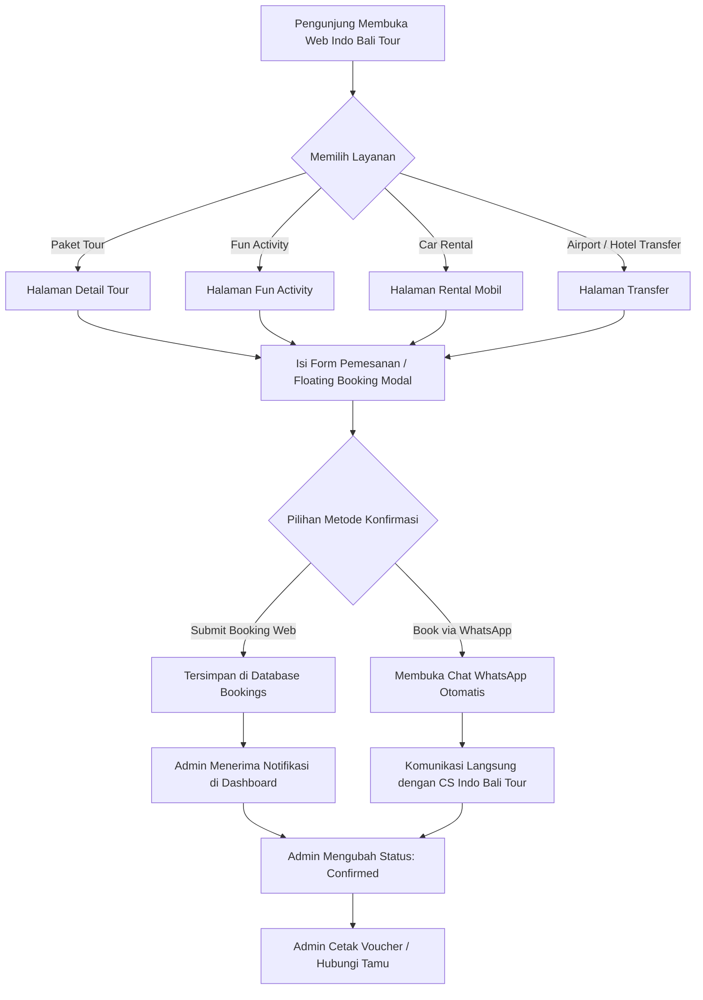

# 🌴 PANDUAN LENGKAP PENGGUNAAN WEBSITE INDO BALI TOUR
> **Indo Bali Tour — Exploring Paradise Together**  
> Panduan komprehensif bagi **Wisatawan / Pengunjung** dan **Administrator / Tim Pengelola** untuk memanfaatkan seluruh fitur website secara optimal.

---

## 📌 Daftar Isi
1. [Tentang Indo Bali Tour](#1-tentang-indo-bali-tour)
2. [Panduan untuk Wisatawan & Pengunjung (Frontend)](#2-panduan-untuk-wisatawan--pengunjung-frontend)
   - [2.1 Navigasi & Tampilan Beranda](#21-navigasi--tampilan-beranda)
   - [2.2 Pengubah Bahasa & Mata Uang](#22-pengubah-bahasa--mata-uang-currency--language)
   - [2.3 Menjelajahi & Memesan Paket Tour](#23-menjelajahi--memesan-paket-tour)
   - [2.4 Menjelajahi & Memesan Fun Activity](#24-menjelajahi--memesan-fun-activity)
   - [2.5 Layanan Rental Mobil (Car Rental)](#25-layanan-rental-mobil-car-rental)
   - [2.6 Layanan Antar-Jemput (Airport & Hotel Transfer)](#26-layanan-antar-jemput-airport--hotel-transfer)
   - [2.7 Alur Pemesanan (Website & WhatsApp Booking)](#27-alur-pemesanan-website--whatsapp-booking)
   - [2.8 Menikmati Galeri Pengalaman & Memberikan Ulasan/Testimoni](#28-menikmati-galeri-pengalaman--memberikan-ulasantestimoni)
   - [2.9 Membaca Blog & Berita Wisata](#29-membaca-blog--berita-wisata)
   - [2.10 Mengenal Tim & Melamar Pekerjaan (Career Form)](#210-mengenal-tim--melamar-pekerjaan-career-form)
   - [2.11 Menghubungi Bantuan (Floating Contact Menu)](#211-menghubungi-bantuan-floating-contact-menu)
3. [Panduan untuk Administrator & Tim (Admin Panel)](#3-panduan-untuk-administrator--tim-admin-panel)
   - [3.1 Akses & Login Admin](#31-akses--login-admin)
   - [3.2 Tinjauan Dashboard & Statistik](#32-tinjauan-dashboard--statistik)
   - [3.3 Manajemen Bookings (Pesanan Masuk)](#33-manajemen-bookings-pesanan-masuk)
   - [3.4 Manajemen Paket Tour](#34-manajemen-paket-tour)
   - [3.5 Manajemen Kendaraan (Car Rental)](#35-manajemen-kendaraan-car-rental)
   - [3.6 Manajemen Fun Activity](#36-manajemen-fun-activity)
   - [3.7 Moderasi Testimoni Pelanggan](#37-moderasi-testimoni-pelanggan)
   - [3.8 Manajemen Blog & Artikel Wisata](#38-manajemen-blog--artikel-wisata)
   - [3.9 Manajemen Lamaran Kerja (Job Applications)](#39-manajemen-lamaran-kerja-job-applications)
   - [3.10 Manajemen Galeri Album Foto & Video Dokumentasi](#310-manajemen-galeri-album-foto--video-dokumentasi)
   - [3.11 Manajemen Layanan Transfer (Bandara & Hotel)](#311-manajemen-layanan-transfer-bandara--hotel)
4. [Diagram Alur Sistem (Booking Workflow)](#4-diagram-alur-sistem-booking-workflow)
5. [Panduan Teknis & Troubleshooting](#5-panduan-teknis--troubleshooting)

---

## 1. Tentang Indo Bali Tour

**Indo Bali Tour** adalah platform website pariwisata modern yang berfokus pada penyediaan layanan perjalanan premium di Pulau Bali dan sekitarnya (termasuk Nusa Penida). Platform ini menggabungkan kemudahan pemesanan digital dengan layanan personal lokal melalui integrasi WhatsApp, konversi mata uang dinamis, serta panel kontrol manajemen konten (CMS) mandiri bagi tim internal.

### ✨ Fitur Unggulan Sistem:
- **Smart Booking System:** Pilihan konfirmasi pemesanan langsung tersimpan ke database sekaligus terhubung ke WhatsApp customer service dengan pesan otomatis terstruktur.
- **Multi-Currency Converter:** Menampilkan harga dalam **USD** dan **IDR** (Rupiah) secara langsung di katalog tur, aktivitas, dan armada kendaraan.
- **Multi-Language Support:** Didukung widget Google Translate yang memungkinkan wisatawan dari seluruh dunia membaca informasi dalam berbagai bahasa.
- **Glassmorphism & Ken Burns Hero:** Pengalaman visual memukau dengan transisi slider foto Bali yang sinematik.
- **Recruitment / Career Integration:** Formulir lamaran kerja online terintegrasi; pelamar yang disetujui (*accepted*) langsung tampil pada laman profil tim publik.
- **Printable Booking Voucher:** Admin dapat mencetak atau menyimpan invoice voucher pesanan pelanggan dalam format PDF/cetak rapi.

---

## 2. Panduan untuk Wisatawan & Pengunjung (Frontend)

### 2.1 Navigasi & Tampilan Beranda
Pada saat membuka website (`/`), pengunjung disuguhi dengan tampilan:
1. **Header / Navbar:** Akses menu navigasi, tombol ganti mata uang, pemilih bahasa, dan logo utama.
2. **Hero Section:** Slider sinematik dengan visual destinasi ikonik Bali, rating kepuasan wisatawan (+2K pelancong), serta tombol cepat *Book Your Tour* dan *Watch Video*.
3. **Statistik Interaktif (Floating Stats Bar):** Menampilkan pencapaian (2K+ Happy Traveler, 50+ Tour Guide, 40+ Destinations, 20+ Partner Hotels) yang dapat diklik untuk membuka galeri foto pop-up.
4. **Our Services:** Pintasan 4 pilar layanan utama: *Fun Activity*, *Tour Packages*, *Car Rental*, dan *Transfer*.
5. **Popular Destinations:** Cuplikan paket tour terfavorit dengan rating dan tarif awal.
6. **Stories & Testimonials:** Korsel ulasan jujur dari wisatawan mancanegara.
7. **Experience & Video:** Album foto dokumentasi dan video YouTube petualangan bersama Indo Bali Tour.

---

### 2.2 Pengubah Bahasa & Mata Uang (Currency & Language)
Untuk kenyamanan wisatawan mancanegara maupun domestik:

* **Mengubah Mata Uang (Currency):**
  - Klik tombol mata uang di kanan atas navbar (misal: `USD` atau `IDR`).
  - Pilih mata uang yang diinginkan.
  - Seluruh harga pada Paket Tour, Fun Activity, Rental Mobil, dan Transfer akan otomatis dikonversi secara instan.
* **Mengubah Bahasa (Language):**
  - Klik ikon bola dunia / nama bahasa di navbar kanan atas.
  - Pilih bahasa asal (misal: *English*, *Indonesia*, *Français*, *Deutsch*, *日本語*, dll.).
  - Konten halaman akan diterjemahkan secara otomatis.

---

### 2.3 Menjelajahi & Memesan Paket Tour
1. Akses menu **Tour > Package Tour** (`/tour/package_tour`).
2. Telusuri pilihan paket (misal: Ubud Cultural Tour, Nusa Penida Island Trip, Uluwatu Sunset Tour, Bali Volcano Sunrise Trekking).
3. Klik tombol **Detail** pada kartu tour yang diminati untuk membuka halaman spesifikasi lengkap (`/tour/detail/{slug}`):
   - **Highlight & Deskripsi:** Gambaran umum destinasi yang dikunjungi.
   - **Itinerary Lengkap:** Rincian jadwal kegiatan per jam dari penjemputan hingga kembali ke hotel.
   - **Included & Excluded:** Fasilitas apa saja yang sudah termasuk (tiket masuk, makan siang, supir berlisensi, bensin) dan yang belum termasuk.
   - **Booking Widget:** Form pemesanan langsung di samping kanan halaman detail.

---

### 2.4 Menjelajahi & Memesan Fun Activity
1. Akses menu **Tour > Fun Activity** (`/tour/fun_activity`).
2. Pilih aktivitas petualangan seru seperti:
   - Watersport di Tanjung Benoa (Parasailing, Jet Ski, Banana Boat, Sea Walker).
   - Ayunan Bali Swing di atas lembah Ubud.
   - Rafting Sungai Ayung / Telaga Waja.
   - ATV Quad Bike melalui trek sawah, goa, dan air terjun.
3. Klik **Detail** pada aktivitas untuk melihat durasi, lokasi, fasilitas keamanan, dan form reservasi cepat.

---

### 2.5 Layanan Rental Mobil (Car Rental)
1. Akses menu **Tour > Car Rental** (`/tour/car_rental`).
2. Tersedia beragam pilihan armada dengan spesifikasi transparan:
   - Jenis kendaraan (Avanza, Innova Reborn, Toyota Hiace, Alphard, dll.).
   - Kapasitas penumpang & kapasitas bagasi koper.
   - Pilihan transmisi (Manual / Automatic).
   - Opsi sewa dengan supir ramah berbahasa Inggris + BBM atau lepas kunci.
3. Klik tombol **Book Car** untuk langsung mengisi detail tanggal dan durasi sewa.

---

### 2.6 Layanan Antar-Jemput (Airport & Hotel Transfer)
1. Buka menu **Transfer > Airport Transfer** atau **Hotel Transfer**:
   - **Airport Transfer:** Layanan penjemputan dari Bandara Internasional I Gusti Ngurah Rai (DPS) menuju hotel di seluruh wilayah Bali (Kuta, Seminyak, Canggu, Ubud, Jimbaran, Sanur, Nusa Dua, Lovina, dll.), lengkap dengan penanda nama (*meet & greet service*).
   - **Hotel Transfer:** Layanan pindah hotel antar-daerah wisata dengan armada nyaman dan pengemudi berpengalaman.
2. Pilih titik asal & tujuan, periksa tarif transparan, lalu masukkan tanggal kedatangan dan detail penerbangan.

---

### 2.7 Alur Pemesanan (Website & WhatsApp Booking)
Pelanggan dapat melakukan reservasi melalui **dua cara yang sangat mudah**:

#### Opsi A: Reservasi Lewat Form Website
1. Klik tombol **Book Now / Book Your Tour** pada halaman tur atau melalui Floating Action Button di pojok kanan bawah.
2. Lengkapi data pemesanan:
   - **Personal Information:** Nama Lengkap, Alamat Email, Nomor WhatsApp/Telepon, Kewarganegaraan.
   - **Tour Details:** Paket yang dipilih, Lokasi Penjemputan (*Pick-up Location* + opsi tautan Google Maps), Lokasi Tujuan (*Drop-off Location*), Tanggal Wisata, Jumlah Peserta (*Total Person*).
   - **Special Request:** Catatan khusus (misal: menu vegetarian, kursi bayi / baby seat, preferensi waktu penjemputan).
3. Klik tombol merah **Submit Booking**.
4. Data langsung tercatat di sistem admin Indo Bali Tour dan tim akan segera menghubungi pelanggan melalui email / WhatsApp.

#### Opsi B: Reservasi Instan via WhatsApp
1. Setelah mengisi form, klik tombol hijau **Book via WhatsApp**.
2. Sistem akan otomatis memformat seluruh data pesanan menjadi teks pesan yang rapi.
3. Anda akan langsung dialihkan ke WhatsApp resmi Customer Care Indo Bali Tour:
   > *"Halo Indo Bali Tour, saya ingin memesan paket [Nama Tour] untuk tanggal [DD/MM/YYYY] sebanyak [X] orang..."*
4. Anda dapat langsung berkonsultasi, bernegosiasi, atau mengonfirmasi penjemputan secara instan!

---

### 2.8 Menikmati Galeri Pengalaman & Memberikan Ulasan/Testimoni
1. Buka halaman **Experiences** (`/tour/experience`).
2. Anda dapat melihat album foto perjalanan para wisatawan terdahulu serta menonton video YouTube ulasan destinasi.
3. **Ingin Berbagi Pengalaman Anda?**
   - Gulir ke bagian **Form Testimoni Pelanggan**.
   - Masukkan Nama Lengkap, Asal Negara/Kota, Rating Bintang (1 hingga 5 bintang), dan Ulasan Anda.
   - Unggah foto liburan Anda bersama tim Indo Bali Tour (opsional).
   - Klik **Kirim Testimoni**. Ulasan Anda akan dimoderasi oleh admin dan langsung ditayangkan di website!

---

### 2.9 Membaca Blog & Berita Wisata
1. Akses menu **Blogs & News** (`/tour/blog_event`).
2. Temukan beragam artikel informatif:
   - Tips berlibur hemat dan aman di Bali.
   - Rekomendasi kuliner halal dan makanan khas Bali.
   - Jadwal perayaan adat & upacara budaya (Nyepi, Galungan, Tari Kecak).
   - Panduan trekking sunrise Gunung Batur.
3. Bagikan artikel ke media sosial favorit Anda.

---

### 2.10 Mengenal Tim & Melamar Pekerjaan (Career Form)
1. Kunjungi menu **Our Team** (`/our-team`).
2. Di sini pengunjung dapat melihat profil para tour guide, supir, dan konsultan perjalanan profesional Indo Bali Tour lengkap dengan kemampuan bahasa asing dan pengalaman mereka.
3. **Ingin Bergabung Menjadi Bagian dari Tim Kami?**
   - Gulir ke bagian formulir **Career / Lowongan Kerja**.
   - Masukkan Nama Lengkap, Nama Panggilan, Email, Nomor Telepon/WhatsApp, dan Alamat Domisili.
   - Pilih Posisi/Profesi yang diminati (misal: *Tour Guide*, *Driver Pariwisata*, *Customer Support*, *Marketing*).
   - Sebutkan Bahasa yang dikuasai (contoh: *English, Indonesian, Japanese*).
   - Unggah **Foto Profil** terbaru dan berkas **CV / Resume** (format PDF/JPG).
   - Tuliskan pesan profil singkat tentang pengalaman Anda.
   - Klik **Submit Application**. Lamaran Anda akan segera ditinjau oleh HRD/Manajemen.

---

### 2.11 Menghubungi Bantuan (Floating Contact Menu)
Di setiap halaman website, pada sudut kanan bawah terdapat **Tombol Bantuan Melayang (FAB)**:
- Klik tombol **Need Help?** berwarna merah marun.
- Menu melayang akan membuka 4 opsi cepat:
  1. 🟢 **Ask Local Expert (WhatsApp):** Chat langsung dengan pemandu lokal.
  2. 🔴 **Email:** Kirim pesan surel langsung ke `info@indobalitour.com`.
  3. 🔵 **Telepon Langsung:** Panggilan darurat/reservasi via nomor resmi kantor.
  4. 📅 **Book a Tour:** Buka jendela pop-up form pemesanan cepat dari halaman manapun.

---

## 3. Panduan untuk Administrator & Tim (Admin Panel)

Panel Admin adalah pusat kendali untuk mengelola seluruh data, konten, pesanan masuk, dan pelamar kerja pada website Indo Bali Tour.

### 3.1 Akses & Login Admin
1. Buka browser dan arahkan ke alamat URL:
   ```
   http://localhost:8000/admin-login
   ```
   *(Atau klik avatar profil di pojok kanan atas navbar jika Anda sudah dalam sesi aktif).*
2. Masukkan **Username** dan **Password** admin Anda.
3. Klik tombol **Login**. Sistem akan mengarahkan Anda ke Dashboard utama di `/admin`.
4. Untuk keluar dari sesi admin, klik menu profil di bilah bawah sidebar lalu pilih **Logout**.

---

### 3.2 Tinjauan Dashboard & Statistik
Halaman Dashboard (`/admin`) memberikan ringkasan data penting secara *real-time*:
- **Statistik Cepat (Counter Cards):** Total Bookings, Paket Tour Aktif, Armada Kendaraan, Fun Activities, Testimoni Masuk, dan Lamaran Kerja Baru.
- **Grafik Tren Booking:** Grafik statistik jumlah pesanan bulanan sepanjang tahun berjalan.
- **Tabel Aktivitas Terkini:**
  - 5 Pesanan (*Bookings*) terbaru yang butuh tindak lanjut.
  - 5 Testimoni terbaru yang menunggu moderasi/persetujuan.
  - 5 Lamaran kerja (*Job Applications*) terbaru yang masuk.

---

### 3.3 Manajemen Bookings (Pesanan Masuk)
Akses melalui menu: **Manajemen Konten > Bookings** (`/admin/bookings`).

Fitur utama pada modul Booking:
1. **Daftar Pesanan:** Menampilkan ID Booking, Nama Pelanggan, Kontak (Email & Nomor WhatsApp), Layanan yang dipesan, Tanggal, dan Status saat ini (*Pending*, *Confirmed*, *Cancelled*).
2. **Lihat Rincian (Detail Booking):**
   - Klik ikon mata / judul booking untuk membuka detail lengkap.
   - Anda dapat memeriksa titik penjemputan (*Pick-up*) dan pengantaran (*Drop-off*) beserta tautan langsung ke **Google Maps** tempat penjemputan wisatawan.
   - Membaca catatan khusus (*Special Request*) dari pelanggan.
3. **Mengubah Status Booking:**
   - Anda dapat mengubah status pesanan via dropdown:
     - `Pending` (Pesanan baru masuk, belum diverifikasi).
     - `Confirmed` (Pesanan sudah dikonfirmasi dengan supir/tamu).
     - `Cancelled` (Pesanan dibatalkan oleh tamu atau kendala jadwal).
4. **Cetak Voucher / Bukti Pesanan (Print Booking):**
   - Klik tombol **Print Voucher** pada halaman detail booking.
   - Sistem akan menyusun layout cetak resmi berkepala surat Indo Bali Tour yang siap dicetak fisik atau disimpan sebagai file **PDF** untuk dikirimkan kepada pelanggan via WhatsApp/Email.
5. **Hapus Pesanan:** Hapus arsip booking yang sudah kedaluwarsa atau pesanan uji coba (*test data*).

---

### 3.4 Manajemen Paket Tour
Akses melalui menu: **Manajemen Konten > Paket Tour** (`/admin/tours`).

* **Menambah Tour Baru:**
  1. Klik tombol **+ Tambah Tour**.
  2. Isi Formulir:
     - **Judul Tour:** Contoh: *"Ubud Art & Waterfall Full Day Tour"*.
     - **Slug (URL):** Dibuat otomatis atau dikustomisasi (contoh: `ubud-art-waterfall-tour`).
     - **Harga (USD):** Masukkan patokan harga dalam dollar (misal: `45.00`).
     - **Durasi & Lokasi:** Contoh: `10 Hours` dan `Gianyar, Bali`.
     - **Deskripsi & Itinerary:** Gunakan editor teks untuk menjabarkan jadwal perjalanan.
     - **Inclusions & Exclusions:** Daftar fasilitas termasuk dan tidak termasuk.
     - **Foto Utama & Galeri Tambahan:** Unggah gambar beresolusi tajam.
     - **Status:** Pilih `Show` (tampil di web) atau `Hide` (disimpan sebagai draft).
  3. Klik **Simpan Tour**.
* **Toggle Status Cepat:** Di tabel daftar tur, klik saklar status untuk langsung mengaktifkan atau menonaktifkan tur tanpa perlu masuk ke form edit.

---

### 3.5 Manajemen Kendaraan (Car Rental)
Akses melalui menu: **Manajemen Konten > Kendaraan** (`/admin/cars`).

* **Menambah / Mengubah Data Mobil:**
  - Masukkan nama kendaraan (misal: *Toyota All New Avanza*, *Innova Venturer*, *Toyota Hiace Commuter 16-Seats*).
  - Tentukan jumlah kapasitas penumpang (contoh: `6 Orang`) dan kapasitas bagasi koper (`3 Koper`).
  - Tentukan jenis transmisi (`Manual` / `Automatic`).
  - Tetapkan harga sewa per 10 atau 12 jam (termasuk Supir & BBM).
  - Unggah foto mobil dengan sudut tampak depan/samping transparan yang bersih.
  - Atur status ketersediaan armada.

---

### 3.6 Manajemen Fun Activity
Akses melalui menu: **Manajemen Konten > Fun Activity** (`/admin/fun_activities`).

* Digunakan untuk mengelola wahana dan aktivitas outdoor:
  - Masukkan judul kegiatan (misal: *Ayung River White Water Rafting*).
  - Masukkan lokasi kegiatan, durasi permainan, dan batas minimal usia jika ada.
  - Masukkan harga tiket per orang.
  - Tuliskan kelengkapan keselamatan yang disediakan (helm, jaket pelampung, asuransi).
  - Unggah foto aksi kegiatan yang memikat calon wisatawan.

---

### 3.7 Moderasi Testimoni Pelanggan
Akses melalui menu: **Manajemen Konten > Testimoni** (`/admin/testimonies`).

Untuk menjaga kualitas dan keaslian ulasan di website:
1. Ulasan yang baru saja dikirimkan pengunjung melalui web publik berstatus **Belum Disetujui (Pending / Unapproved)**.
2. Admin dapat membaca ulasan, melihat foto yang dikirimkan tamu, serta melihat rating bintang yang diberikan.
3. Klik tombol hijau **Approve** untuk menyetujui ulasan agar langsung tampil pada slider testimoni di Beranda dan halaman *Experiences*.
4. Jika ada komentar spam atau kata-kata tidak pantas, admin dapat menyunting (*Edit*) atau langsung menghapusnya (*Delete*).

---

### 3.8 Manajemen Blog & Artikel Wisata
Akses melalui menu: **Manajemen Konten > Blog & News** (`/admin/blogs`).

* **Membuat Artikel Baru:**
  1. Klik tombol **+ Tambah Artikel**.
  2. Masukkan **Judul Artikel**, **Kategori** (misal: *Travel Tips*, *Culture*, *Culinary*, *Events*), dan **Tag**.
  3. Unggah **Gambar Sampul (Thumbnail)** artikel.
  4. Tulis konten artikel menggunakan editor Summernote (mendukung format tebal, miring, list nomor, tautan, dan penyisipan foto di badan tulisan).
  5. Tentukan status publikasi: `Show` untuk langsung terbit atau `Hide` untuk draf.
  6. Klik **Simpan Artikel**.

---

### 3.9 Manajemen Lamaran Kerja (Job Applications)
Akses melalui menu: **Manajemen Konten > Job Applications** (`/admin/job_applications`).

Fitur canggih rekrutmen terintegrasi Indo Bali Tour:
1. **Melihat Pelamar:** Menampilkan nama pelamar, posisi yang dilamar (Driver, Tour Guide, dsb.), nomor telepon/WA, bahasa asing yang dikuasai, domisili/asal, dan tanggal melamar.
2. **Review Detail Lamaran:**
   - Klik nama pelamar untuk melihat profil lengkap dan pesan motivasi.
   - Klik tautan **Download CV** untuk mengunduh dan memeriksa dokumen resume pelamar.
   - Lihat foto profil pelamar.
3. **Mengubah Status Lamaran:**
   - `Pending` (Lamaran baru diterima).
   - `Reviewed` (Berkas telah diperiksa HRD).
   - `Interview` (Pelamar dipanggil untuk wawancara).
   - `Accepted` (Pelamar resmi diterima menjadi tim Indo Bali Tour).
   - `Rejected` (Lamaran ditolak).
4. ⭐ **Otomatisasi Tampil di Tim Publik:**
   - **Setiap pelamar yang statusnya diubah menjadi `Accepted` akan secara otomatis muncul sebagai anggota tim aktif di halaman website `/our-team`** lengkap dengan foto, nama, posisi, dan kemampuan bahasa!

---

### 3.10 Manajemen Galeri Album Foto & Video Dokumentasi
Akses melalui menu: **Experiences > Photo Gallery** (`/admin/albums`) dan **Video Gallery** (`/admin/videos`).

* **Photo Gallery (Album Wisata):**
  - Buat album baru dengan judul destinasi (misal: *"Private Honeymoon Trip in Nusa Dua"*).
  - Unggah foto sampul album.
  - Masuk ke detail album untuk mengunggah **banyak foto sekaligus (multi-upload)** dokumentasi tamu.
  - Hapus foto tertentu jika sudah tidak relevan.
* **Video Gallery:**
  - Tambahkan tautan video YouTube dokumentasi liburan pelanggan.
  - Cukup tempelkan tautan YouTube (misal: `https://www.youtube.com/watch?v=XXXXX`), sistem akan otomatis mengambil *thumbnail* video dari YouTube untuk dipajang di beranda.

---

### 3.11 Manajemen Layanan Transfer (Bandara & Hotel)
Akses melalui menu:
- **Transfer Service > Airport Transfer** (`/admin/airports`)
- **Transfer Service > Hotel Transfer** (`/admin/hotel_transfers`)

* **Menentukan Tarif Rute:**
  - Tambahkan zona area tujuan (misal: *Ngurah Rai Airport ke Ubud Sentral*, *Airport ke Lovina Singaraja*, *Kuta ke Seminyak*).
  - Tetapkan harga transfer dalam satuan USD/IDR.
  - Tentukan kapasitas muatan maksimal per kendaraan transfer.
  - Aktifkan atau nonaktifkan rute sesuai ketersediaan operasional.

---

## 4. Diagram Alur Sistem (Booking Workflow)



---

## 5. Panduan Teknis & Troubleshooting

### 5.1 Persyaratan Sistem
- **Web Server:** Apache / Nginx (atau bawaan Laragon / XAMPP)
- **Bahasa Pemrograman:** PHP >= 8.2
- **Basis Data:** MySQL 8.x / MariaDB 10.x
- **Dependency Manager:** Composer & Node.js (NPM)

### 5.2 Perintah Penting (Command Line)
Buka terminal PowerShell pada direktori proyek (`c:\laragon\www\IndoBaliTour\IndoBaliTour`):

1. **Membuat Symlink Penyimpanan Gambar (Wajib setelah clone/migrasi):**
   ```bash
   php artisan storage:link
   ```
2. **Membersihkan Cache Konfigurasi & Tampilan:**
   ```bash
   php artisan optimize:clear
   ```
3. **Menjalankan Server Lokal:**
   ```bash
   php artisan serve
   ```
4. **Kompilasi Aset Frontend (Tailwind CSS & JavaScript):**
   ```bash
   npm run dev
   # Atau untuk build produksi:
   npm run build
   ```

### 5.3 Troubleshooting Pertanyaan yang Sering Muncul (FAQ)

| Kendala / Pertanyaan | Kemungkinan Penyebab | Cara Mengatasi |
| :--- | :--- | :--- |
| **Foto testimoni atau CV pelamar tidak tampil / gambar pecah** | Folder penyimpanan berkas belum tertaut (*symlink missing*). | Jalankan perintah `php artisan storage:link` di terminal. Pastikan folder `public/storage` ada. |
| **Pesan WhatsApp tidak terkirim atau nomor salah** | Data kontak di basis data belum disesuaikan. | Periksa tabel `pengaturan` di database. Ubah kolom `phone` dengan format internasional tanpa spasi (contoh: `6285858777754`). |
| **Harga mata uang tidak berubah saat memilih IDR** | Cache JavaScript browser atau koneksi API rate limit. | Muat ulang halaman (*Hard Refresh* `Ctrl + F5`). Konverter memiliki nilai tukar cadangan (*fallback rate*) otomatis jika koneksi API sedang lambat. |
| **Ulasan pengunjung tidak muncul di halaman depan** | Ulasan masih berstatus *unapproved*. | Masuk ke **Admin Panel > Testimoni**, cari ulasan yang baru masuk, lalu klik tombol centang hijau **Approve**. |
| **Pelamar kerja yang diterima belum muncul di halaman tim** | Status lamaran belum diganti ke `accepted`. | Buka **Admin Panel > Job Applications**, buka detail pelamar, dan ubah statusnya menjadi **Accepted**. |
| **Lupa password login admin** | Butuh reset kredensial pengguna. | Jalankan `php artisan tinker`, lalu eksekusi:<br>`$user = App\Models\User::first();`<br>`$user->password = Hash::make('password_baru_anda');`<br>`$user->save();` |

---

> 📄 *Dokumen ini disusun untuk memudahkan operasional harian tim Indo Bali Tour dan memberikan panduan menyeluruh bagi pengguna dan pengembang sistem.*  
> **Indo Bali Tour — Exploring Paradise Together**

